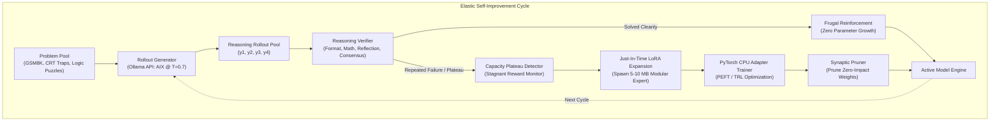

# `aix-evolver` 🧠🌱

> **Elastic Reasoning Self-Improvement Engine**: Autonomous, parameter-frugal self-play and dynamic neural architecture expansion for local models.

[](https://github.com/pfolex/aix-evolver/actions)
[](https://opensource.org/licenses/MIT)
[](https://www.python.org/)
[](https://ollama.ai)

---

## What is `aix-evolver`?

Modern AI development faces a dilemma: **small models (1.5B–3B) are fast and lightweight, but lack capacity for deep reasoning, while large models (8B–70B) are smart, but slow down consumer CPUs and exhaust RAM.**

`aix-evolver` solves this through an **Elastic Reasoning Architecture (ERA)**:
1. **Frugal Core**: AIX starts with a compact 1.5B neural network (running at 14–20 tokens/sec on CPU).
2. **Autonomous Reasoning Self-Play**: The model samples multi-path reasoning rollouts, verified by rule-based verifiers and multi-path consensus.
3. **Plateau Detection**: If the model repeatedly fails a class of logic due to representation bottlenecks, the engine detects the plateau.
4. **Just-In-Time Modular Growth**: Instead of bloating into a giant slow model, `aix-evolver` dynamically spawns a lightweight **5–10 MB LoRA expert module** dedicated to that reasoning skill.
5. **Synaptic Pruner**: Regularly evaluates active adapters and prunes inactive weights to ensure the neural network remains as lean and fast as possible.

---

## Architecture Flow



---

## Installation

### Prerequisites
* Python 3.9+
* [Ollama](https://ollama.ai) running locally (`ollama run aix` or any local model)

```bash
git clone https://github.com/pfolex/aix-evolver.git
cd aix-evolver
pip install -e .
```

To install development dependencies (testing and linting):
```bash
pip install -e ".[dev]"
```

---

## Quickstart

### 1. Inspect the Parameter Economy
View current base parameters, active modular experts, and memory footprint:
```bash
aix-evolver status
```

### 2. Run Autonomous Evolution
Run an evolution loop for 5 reasoning steps on your local model:
```bash
aix-evolver evolve --steps 5 --model aix --group-size 3
```

Options:
* `--steps`: Number of curriculum problems to evaluate.
* `--model`: Local model name in Ollama (e.g. `aix`, `deepseek-r1:1.5b`, `aix:8b`).
* `--group-size`: Number of exploratory rollouts per problem (default: `3`).
* `--dry-run`: Simulate weight updates without GPU/CPU backprop for fast CI testing.

---

## Project Structure

```text
aix-evolver/
├── aix_evolver/
│   ├── __init__.py           # Package exports
│   ├── __version__.py        # Version 0.1.0
│   ├── cli.py                # Rich terminal interface & dashboard
│   ├── dataset.py            # Problem curriculum & plateau tracking
│   ├── elastic_brain.py      # Plateau detector & dynamic LoRA modular growth
│   ├── generator.py          # Multi-path streaming rollout engine
│   ├── trainer.py            # CPU-optimized PEFT/LoRA gradient step engine
│   └── verifier.py           # Multi-signal verification & consensus detection
├── tests/
│   ├── test_dataset.py
│   ├── test_elastic_brain.py
│   ├── test_trainer.py
│   └── test_verifier.py
├── .github/
│   └── workflows/
│       └── ci.yml            # Automated GitHub Actions test suite
├── pyproject.toml            # Hatchling build specification
├── LICENSE                   # MIT License
└── README.md
```

---

## Running Unit Tests

Run the full pytest suite:
```bash
pytest tests/ -v
```

All 12 unit tests verify:
* Problem curriculum and failure tracking
* Mathematical and LaTeX boxed answer extraction
* Reflection intensity and repetition detection
* Multi-path consensus detection
* Plateau detection and dynamic LoRA expert spawning
* Synaptic expert pruning
* CPU training steps and checkpoint serialization

---

## Contributing & License

Authored by **Alex Pfeil** ([@pfolex](https://github.com/pfolex)).  
Distributed under the **MIT License**. See `LICENSE` for details.
